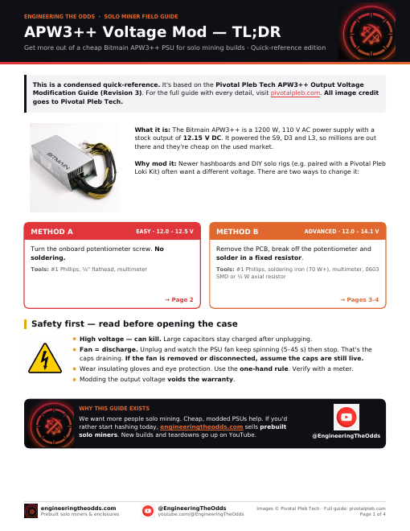
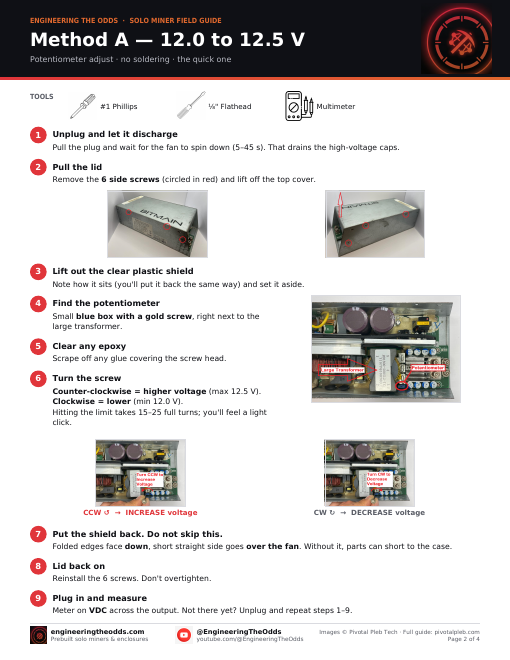
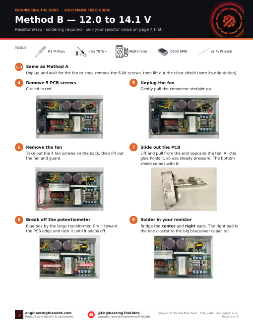
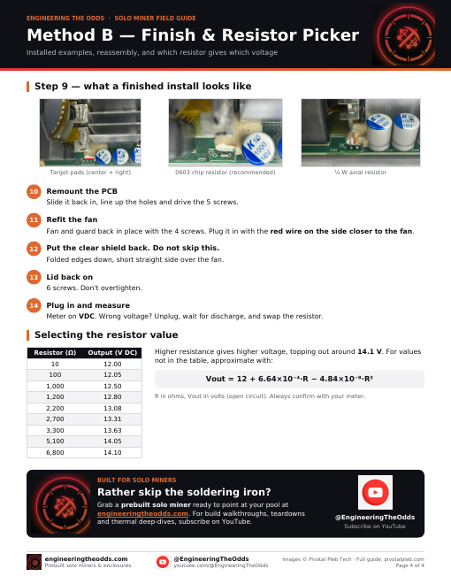

<p align="center">
  <a href="https://engineeringtheodds.com/?utm_source=github&utm_medium=readme&utm_campaign=apw3-guide&utm_content=logo">
    
  </a>
</p>

<h1 align="center">APW3++ Voltage Mod for Loki Miner Builds & Bitcoin Solo Mining</h1>

<p align="center">
  <b>Change the output of a Bitmain APW3++ PSU from 12.15 V up to 14.1 V.</b><br>
  A free, printable TL;DR guide for Loki miner builds, DIY rigs and Bitcoin solo mining at home.
</p>

<p align="center">
  <a href="guide/APW3-Voltage-Mod-TLDR.pdf"><b>📄 Download the PDF</b></a> ·
  <a href="https://engineeringtheodds.com/?utm_source=github&utm_medium=readme&utm_campaign=apw3-guide&utm_content=top_nav"><b>🛒 Shop prebuilt miners</b></a> ·
  <a href="https://www.youtube.com/@EngineeringTheOdds"><b>▶️ YouTube</b></a><br>
  <a href="#-apw3-for-loki-miner-builds">Loki Miner</a> ·
  <a href="#-bitcoin-solo-mining-engineering-the-odds">Bitcoin Solo Mining</a> ·
  <a href="#-quick-reference">Quick Reference</a> ·
  <a href="#-faq">FAQ</a>
</p>

---

## ⚡ Skip the mod: get a prebuilt Bitcoin solo miner

This guide is free because we want more people Bitcoin solo mining. If you'd rather start hashing today than open up a power supply:

**[Engineering The Odds](https://engineeringtheodds.com/?utm_source=github&utm_medium=readme&utm_campaign=apw3-guide&utm_content=hero)** sells:

- 🔧 **Prebuilt solo miners.** Assembled, tested and ready to point at your pool.
- 🧊 **3D-printed mining enclosures** designed for airflow, noise and heat, including the **FlowBlock X1**.
- 🏠 **Home-friendly setups** for miners who want to run hashboards on a standard 110/120 V outlet.

👉 **[Browse miners & cases at engineeringtheodds.com](https://engineeringtheodds.com/?utm_source=github&utm_medium=readme&utm_campaign=apw3-guide&utm_content=hero_cta)**

---

## 📄 The Guide

| Page 1: Overview & Safety | Page 2: Method A (12.0–12.5 V) |
|:---:|:---:|
|  |  |
| **Page 3: Method B (12.0–14.1 V)** | **Page 4: Resistor Picker** |
|  |  |

**[⬇️ Download the full-resolution PDF](guide/APW3-Voltage-Mod-TLDR.pdf)**

---

## 🔍 Quick Reference

### Which method do I need?

| | **Method A: Potentiometer** | **Method B: Resistor Swap** |
|---|---|---|
| **Voltage range** | 12.0 – 12.5 V DC | 12.0 – 14.1 V DC |
| **Soldering** | No | Yes (70 W+ iron) |
| **Difficulty** | Easy | Advanced |
| **Tools** | #1 Phillips, ⅛" flathead, multimeter | #1 Phillips, soldering iron, multimeter, 0603 SMD or ¼ W axial resistor |

### Method A: 12.0 to 12.5 V (no soldering)

1. Unplug the PSU and **wait for the fan to spin down** (5–45 s). That discharges the high-voltage capacitors.
2. Remove the 6 side screws and lift off the top cover.
3. Lift out the clear plastic insulating shield and note its orientation.
4. Find the **potentiometer**: a small blue box with a gold screw, next to the large transformer.
5. Remove any epoxy from the screw head.
6. Turn the screw **counter-clockwise to raise** the voltage or **clockwise to lower** it. Each limit is 15–25 turns away, and you'll feel a light click when you reach it.
7. **Reinstall the insulating shield.** Folded edges go down and the short straight side goes over the fan.
8. Reinstall the cover. Don't overtighten the screws.
9. Plug in and measure with a multimeter on VDC. Repeat until you reach the voltage you want.

### Method B: 12.0 to 14.1 V (resistor swap)

1. Follow Method A steps 1–3.
2. Remove the 5 PCB mounting screws and unplug the fan connector.
3. Remove the 4 fan screws on the back, then lift out the fan.
4. Slide the PCB out from the end opposite the fan. The bottom shield comes with it.
5. **Break off the potentiometer**: pry it toward the PCB edge and rock it until it snaps.
6. **Solder a resistor across the center and right pads.** The right pad is the one nearest the large blue and silver capacitor.
7. Reassemble: PCB, then the fan (red wire on the side closer to the fan), then the **insulating shield**, then the cover.
8. Plug in and measure. Wrong voltage? Discharge the PSU and swap the resistor.

### Resistor value → output voltage

| Resistor (Ω) | 10 | 100 | 1,000 | 1,200 | 2,200 | 2,700 | 3,300 | 5,100 | 6,800 |
|---|---|---|---|---|---|---|---|---|---|
| **Vout (V DC)** | 12.00 | 12.05 | 12.50 | 12.80 | 13.08 | 13.31 | 13.63 | 14.05 | 14.10 |

For values not in the table, use this approximation (R in ohms):

```
Vout ≈ 12 + 6.64e-4 · R − 4.84e-8 · R²
```

---

## 🐺 APW3++ for Loki Miner Builds

A **Loki miner** build pairs a modern Bitcoin hashboard with a cheap Bitmain APW3++ power supply through a **Loki Kit from [Pivotal Pleb Tech](https://pivotalpleb.com/)**. That lets you run newer-generation hashboards from a standard **120 V household outlet**.

Hashboards often want more or less than the APW3++'s stock 12.15 V, which is where this mod comes in:

- **Need a small bump or trim (12.0–12.5 V)?** Use **Method A** and turn the potentiometer.
- **Need more voltage (up to 14.1 V)?** Use **Method B**: swap the potentiometer for a fixed resistor and pick the value from the table.

Check your hashboard's and Loki Kit's recommended input voltage on [pivotalpleb.com](https://pivotalpleb.com/) before you set the PSU.

> *Loki and Loki Kit are products of Pivotal Pleb Tech. Engineering The Odds is not affiliated with Pivotal Pleb Tech. "Loki miner" is used here only to describe builds that use their kit.*

---

## 🎲 Bitcoin Solo Mining: Engineering the Odds

**Bitcoin solo mining** means pointing your miner at a solo pool instead of a shared pool. You don't earn steady small payouts. Instead, if *your* miner finds a block, **you keep the full block reward** (3.125 BTC plus transaction fees).

The odds of hitting a block are long, like a lottery ticket that keeps running 24/7. That's why solo miners care so much about:

- **Cheap, efficient power:** a modded APW3++ running off a household circuit.
- **Quiet, cool hardware** that can run at home without driving you out of the room.
- **Uptime:** every hash is another ticket.

Popular solo pools include **CKPool Solo** and **Public Pool**. Set your Bitcoin address as the worker name and you're in the game.

👉 **Want to start Bitcoin solo mining without building it yourself?** [Get a prebuilt solo miner and enclosure at engineeringtheodds.com](https://engineeringtheodds.com/?utm_source=github&utm_medium=readme&utm_campaign=apw3-guide&utm_content=solo_section).

---

## ⚠️ Safety Warning

> **HIGH VOLTAGE: risk of serious injury or death.** The APW3++ holds a dangerous charge in its capacitors after it's unplugged. The fan discharges them. **If the fan has been removed or disconnected, assume the capacitors are still live.** Wear insulating gloves and eye protection, use the one-hand rule, and confirm the PSU is dead with a meter before you touch anything. Modifying the PSU **voids its warranty**. You do this at your own risk.

---

## ❓ FAQ

<details>
<summary><b>What is the Bitmain APW3++ power supply?</b></summary>

The APW3++ is a 1200 W Bitmain PSU that runs on a standard 110 V AC outlet and outputs 12.15 V DC. It originally powered the Antminer S9, D3 and L3. Because millions were made, it's cheap and easy to find used.
</details>

<details>
<summary><b>Can I increase the APW3++ voltage to 13 V or 14 V?</b></summary>

Yes, with Method B. Swapping the potentiometer for a fixed resistor raises the output to as much as about 14.1 V. For example, a 2.2 kΩ resistor gives about 13.08 V, and 5.1 kΩ gives about 14.05 V.
</details>

<details>
<summary><b>How do I lower the APW3++ voltage to 12 V?</b></summary>

Use Method A. Turn the potentiometer screw clockwise until you feel a light click, which gives about 12.0 V. No soldering is needed.
</details>

<details>
<summary><b>Why would a solo miner mod an APW3++?</b></summary>

Newer hashboards and DIY solo-mining rigs often need a voltage other than the stock 12.15 V. A modded APW3++ is one of the cheapest ways to power them from a household outlet, for example with a Loki Kit from Pivotal Pleb Tech.
</details>

<details>
<summary><b>What is a Loki miner?</b></summary>

"Loki miner" is the common name for a DIY build that uses a **Loki Kit from Pivotal Pleb Tech** to power a newer-generation Bitcoin hashboard from a 120 V outlet, usually with an APW3++ PSU. See [pivotalpleb.com](https://pivotalpleb.com/) for the kit itself.
</details>

<details>
<summary><b>What voltage should I set the APW3++ to for a Loki miner?</b></summary>

It depends on your hashboard and kit, so check Pivotal Pleb Tech's recommendation first. Then use Method A for 12.0–12.5 V, or Method B with the resistor table to go as high as 14.1 V. Always confirm the result with a multimeter.
</details>

<details>
<summary><b>What is Bitcoin solo mining?</b></summary>

Bitcoin solo mining means mining on your own (or through a solo pool) instead of sharing rewards in a regular pool. If your miner finds a block, you get the entire block reward. If it doesn't, you get nothing. Low odds, big payoff.
</details>

<details>
<summary><b>Is Bitcoin solo mining worth it?</b></summary>

As steady income, usually not, because a home miner's chance of finding a block on any given day is tiny. Most people solo mine for the shot at a full block, to support decentralization, and to use the heat at home. Treat it as a long-odds bet and size your power costs accordingly.
</details>

<details>
<summary><b>Is there an easier way to start solo mining Bitcoin?</b></summary>

Yes. You can skip the PSU work and buy a **[prebuilt solo miner from Engineering The Odds](https://engineeringtheodds.com/?utm_source=github&utm_medium=readme&utm_campaign=apw3-guide&utm_content=faq)**. It ships assembled and tested, and you can house it in one of our 3D-printed enclosures.
</details>

<details>
<summary><b>Where can I find the full, detailed guide?</b></summary>

The original **APW3++ Output Voltage Modification Guide (Revision 3)** by Pivotal Pleb Tech is at **[pivotalpleb.com](https://pivotalpleb.com/)**.
</details>

---

## 🎥 Watch on YouTube

<a href="https://www.youtube.com/@EngineeringTheOdds"></a>

**[@EngineeringTheOdds](https://www.youtube.com/@EngineeringTheOdds)** covers solo-miner builds, hardware teardowns, thermal design and PSU mods.
**Subscribe** so you don't miss new build videos.

<br clear="left">

---

## 🙏 Credits

- **Original guide and all images:** [Pivotal Pleb Tech](https://pivotalpleb.com/), *APW3++ Output Voltage Modification Guide, Revision 3*. All image credit belongs to Pivotal Pleb Tech. For the complete guide, visit [pivotalpleb.com](https://pivotalpleb.com/).
- **TL;DR condensation and layout:** [Engineering The Odds](https://engineeringtheodds.com/?utm_source=github&utm_medium=readme&utm_campaign=apw3-guide&utm_content=credits).

**Found this useful? ⭐ Star the repo** so other solo miners can find it.

---

<p align="center">
  <a href="https://engineeringtheodds.com/?utm_source=github&utm_medium=readme&utm_campaign=apw3-guide&utm_content=footer">
    
  </a><br>
  <b><a href="https://engineeringtheodds.com/?utm_source=github&utm_medium=readme&utm_campaign=apw3-guide&utm_content=footer">engineeringtheodds.com</a></b>: prebuilt solo miners & mining enclosures<br>
  <sub>Keywords: Loki miner · Loki Kit APW3 · Bitcoin solo mining · solo Bitcoin miner · APW3++ voltage mod · Bitmain APW3 power supply · APW3 14V mod · DIY Bitcoin miner · home Bitcoin mining · home mining PSU · hashboard power supply · mining enclosure · FlowBlock X1</sub>
</p>
